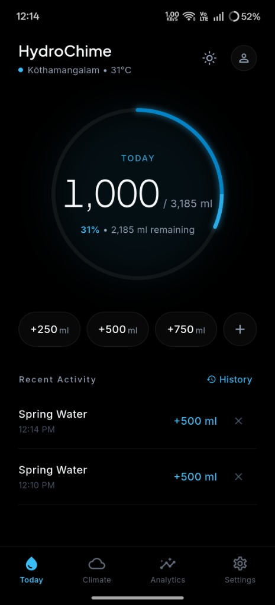
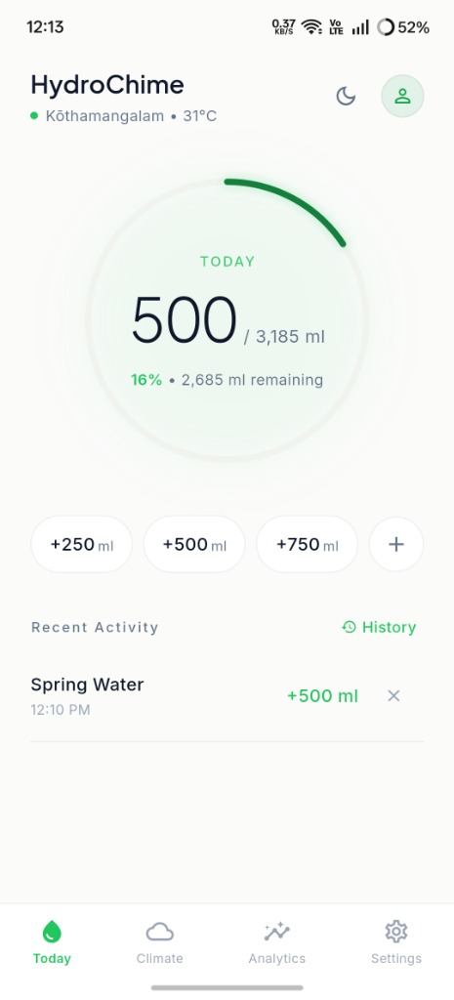
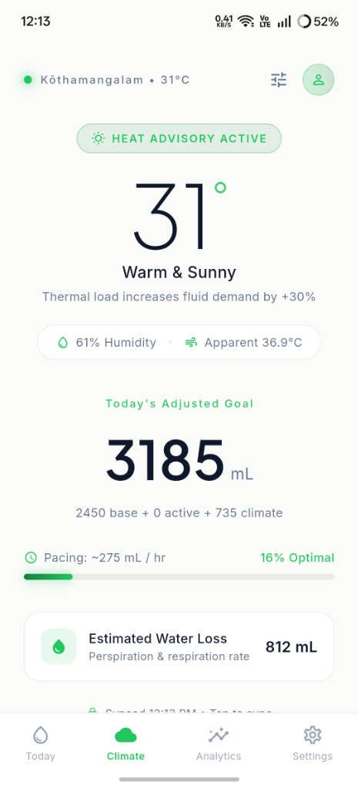
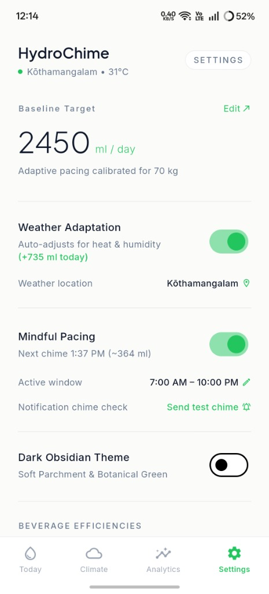

<div align="center">
  
  <h1>HydroChime</h1>
  <p>
    <strong>Climate-adaptive, local-first hydration tracker built with Flutter.</strong>
  </p>
  <p>
    Dynamically adjusts your daily fluid target using body weight, physical exertion, beverage bioavailability, and live local weather — with zero account sign-up and on-device SQLite storage.
  </p>
</div>

---

## Screenshots

| Today (Dark Obsidian) | Today (Light Botanical) | Climate Adaptation | Settings & Pacing |
| :---: | :---: | :---: | :---: |
|  |  |  |  |

---

## Features

### Adaptive Hydration Engine
- **Personalized Baseline (`B`):** Calculated from body weight (`weight_kg × 35 mL`) with optional manual baseline override (`custom_baseline_ml`).
- **Exertion Compensation (`A`):** Adds `12 mL` per minute of logged daily activity (`daily_activity_minutes`).
- **Beverage Bioavailability Multipliers:**
  - **Spring Water:** `×1.00`
  - **Herbal Tea:** `×1.00`
  - **Cellular Electrolytes:** `×1.45`
  - **Coffee & Black Tea:** `×0.80`
- **Quick-Log & Full Activity History:** Log `+250 ml`, `+500 ml`, `+750 ml`, or custom beverage volumes, long-press quick-log pills to pick beverage type, edit or delete entries with undo support, and automatically roll over at midnight.

### Climate-Aware Scaling & Privacy-First Location
- **Live Weather Telemetry:** Queries **Open-Meteo** (no API key required) for temperature, relative humidity, and apparent temperature to compute your climate multiplier (`(B + A) × C_factor`) and estimated perspiration/respiration water loss.
- **Heat & Humidity Multipliers:** Automatically scales targets by `+15%` (`22–29.9°C`) or `+30%` (`≥30°C`), plus extra compensation for arid (`<30%` humidity) or humid hot conditions (`>75%` humidity at `≥28°C`).
- **GPS + Automatic Public IP Fallback:** Prompts for device GPS permission when needed and automatically falls back to HTTPS IP geolocation (`ipwho.is` → `get.geojs.io` → `ipapi.co`) if GPS permission is denied or disabled. Also supports worldwide city search via Open-Meteo Geocoding and quick city presets.
- **Coordinate Anonymization & Caching:** Rounds coordinates to 2 decimal places (`~1.1 km` precision) before weather queries and caches telemetry in SQLite for 3 hours with offline fallback.

### Mindful Hydration Chimes
- Schedules calm, evenly spaced local notifications strictly within your active window (`active_window_start_hour` to `active_window_end_hour`, including overnight shifts).
- Automatically skips or cancels remaining chimes once your daily target is met, and lets you trigger an instant **Send test chime** check from Settings.

### Analytics & Consistency Scoring
- **Day / Week / Month Views:** Inspect interactive intake bars, period averages, goal completion streaks, and beverage mix breakdown.
- **Pacing Consistency Score (0–100%):** Evaluates intake regularity across waking hours using coefficient of variation, prolonged zero-intake gap penalties, and binge-drinking penalties.
- **CSV Export:** Export your logged intake timeline directly from Analytics via Share or Save.

### Local Data Vault & Dual Themes
- **100% On-Device SQLite (`hydrochime.db`):** Stores profile settings, intake logs, daily summaries, and weather cache locally (`sqflite` on mobile/macOS, `sqflite_common_ffi` on Windows/Linux).
- **Backup & Restore:** Export a structured JSON snapshot of your profile, intake logs, and daily summaries (`Share` or save file) and restore from `.json` backups.
- **Dual Themes:** Switch live between **Dark Obsidian & Cyan** (`#000000` / `#0EA5E9`) and **Soft Parchment & Botanical Green** (`#FBFBFA` / `#16A34A`).

---

## Architecture & Project Structure

```text
lib/
├── core/theme/                 # Stitch-inspired color tokens, dark/light ThemeData, typography
├── data/
│   ├── database/               # SQLite schema (v4) & migrations (hydrochime.db)
│   ├── repositories/           # User profile, intake logs, daily summaries, weather cache
│   └── services/               # GPS/IP location, Open-Meteo API, local notifications, JSON/CSV vault
├── domain/
│   ├── calculators/            # Hydration target & pacing consistency algorithms
│   ├── models/                 # UserProfile, IntakeLog, BeverageType, ClimateCondition
│   └── services/               # Active-window chime schedule planner
└── presentation/
    ├── providers/              # Riverpod state notifiers & location bootstrap lifecycle
    ├── screens/                # Today, Climate, Analytics, Settings, MainTabShell
    └── widgets/                # Zen circular gauge, quick-log bar, location picker, calibration sheets
```

---

## Getting Started

### Prerequisites
- **Flutter:** `3.47.9` (`channel stable`)
- **Dart SDK:** `^3.13.7`
- **Android Build:** Java 17 & Android SDK (`compileSdk = 37`)

### Local Development & Testing

```bash
# Install dependencies
flutter pub get

# Run static analysis
flutter analyze

# Run full unit & widget test suite
flutter test

# Run the app
flutter run

# Build Android release APK (outputs to build/app/outputs/flutter-apk/app-release.apk)
flutter build apk --release
```

---

## CI / Automated Release APK

GitHub Actions workflow [`.github/workflows/release-apk.yml`](.github/workflows/release-apk.yml) runs automatically on every push to `main` (and via manual `workflow_dispatch`):

1. Runs `flutter pub get`, `flutter analyze`, and `flutter test` using Flutter `3.47.9`.
2. Sets up Temurin Java 17 and provisions Android SDK licenses / `platforms;android-37.0` / `build-tools;36.0.0`.
3. Builds `build/app/outputs/flutter-apk/app-release.apk` with `flutter build apk --release`.
4. Uploads the APK as the `hydrochime-release-apk` workflow artifact (30-day retention) and updates the rolling **`latest`** pre-release (`HydroChime Latest`) on GitHub Releases with `HydroChime-latest.apk`, size, and SHA-256 summary whenever built from `main`.

> **Signing note:** [`android/app/build.gradle.kts`](android/app/build.gradle.kts) currently uses debug signing keys for `buildTypes.release` so local and CI APKs build out of the box for sideloading/testing. Configure a release keystore and Gradle signing secrets before publishing to the Play Store.
