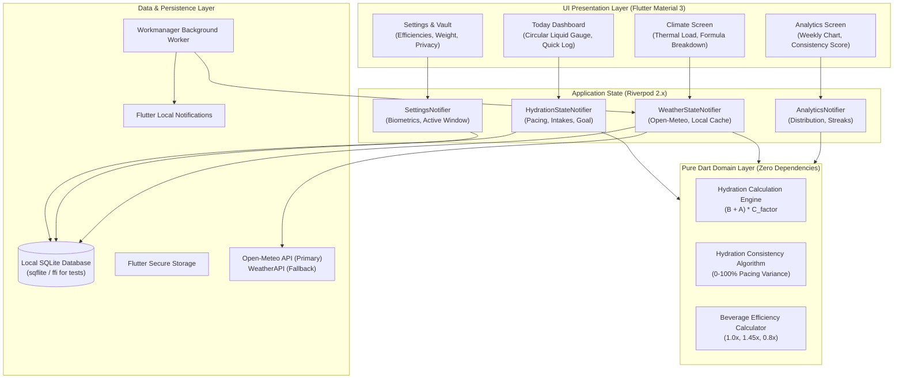
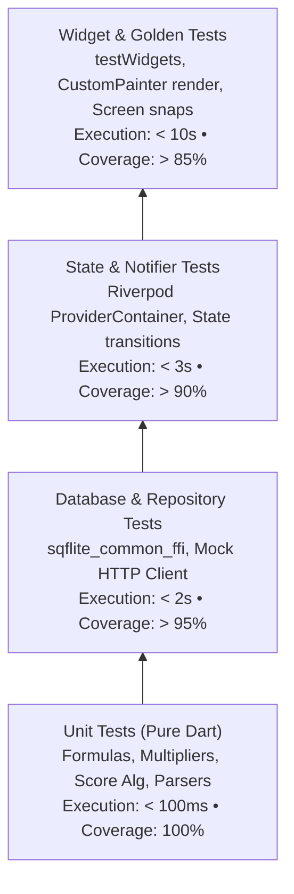

# HydroChime: Stitch Design Analysis & TDD Development Plan

---

## 1. Executive Summary & Architecture Overview

**HydroChime** (also referenced in design specs as *HydroClime Vitality*) is a privacy-first, offline-first hydration companion engineered with **Flutter** and **Riverpod**. Unlike standard static trackers, HydroChime combines a biometric baseline equation with localized atmospheric weather telemetry (ambient temperature and relative humidity) to compute dynamic daily fluid targets and pacing metrics.



---

## 2. Stitch Design System Analysis

The provided Stitch design artifacts (`stitch_nature_material_ui_design/`) specify an atmospheric, restorative, zen aesthetic balancing deep contrast with soft oceanic luminous glows.

### 2.1 Color Palette & Theme Tokens

| Token Name | Dark Mode (Default) | Light Mode (Complement) | Usage in Flutter UI |
| :--- | :--- | :--- | :--- |
| **`surfaceCanvas`** | `#000000` (Obsidian Pitch Black) | `#FBFBFA` (Soft Linen Canvas) | Scaffold background |
| **`surfaceCard`** | `#08080A` (Atmospheric Carbon) | `#FFFFFF` (Crisp Pure White) | Cards, Quick Log wells, tiles |
| **`surfaceElevated`** | `#121316` (Deep Slate Tint) | `#F4F4F0` (Pale Parchment) | Modals, bottom sheets, navigation |
| **`primaryVital`** | `#0EA5E9` (Crisp Ocean Cyan) | `#16A34A` (Lush Vital Green) | Active ring fill, primary buttons |
| **`primaryAtmosphere`**| `#38BDF8` (Sky Highlight) | `#22C55E` (Sprout Green) | Glow effects, badges, active tabs |
| **`primaryDeep`** | `#0284C7` / `#2563EB` | `#15803D` / `#14532D` | Progress gradients, secondary bars |
| **`borderSubtle`** | `rgba(255, 255, 255, 0.06)` | `rgba(0, 0, 0, 0.06)` | Dividers, outline cards |
| **`borderFocus`** | `rgba(14, 165, 233, 0.40)` | `rgba(22, 163, 74, 0.40)` | Active switches, selected pills |
| **`textPrimary`** | `#F8FAFC` (High contrast white) | `#0F172A` (Deep Slate) | Large metrics, titles |
| **`textSecondary`** | `#94A3B8` (Muted slate) | `#64748B` (Neutral slate) | Captions, subtitles, units |
| **`textTertiary`** | `#475569` | `#94A3B8` | Subtle stamps, timestamps |

### 2.2 Typography Hierarchy

* **Headline / Numerical Metrics**: **Plus Jakarta Sans**
  * `Display Large`: `42px` to `64px`, Light/Bold (`FontWeight.w300` / `w700`), Tabular figures enabled (`FontFeature.tabularFigures()`) to prevent layout jitter during count animations.
  * `Headline Large`: `20px` to `24px`, Semi-bold (`FontWeight.w600`).
* **Body / Meta / Labels**: **Inter**
  * `Body Regular`: `14px` (`FontWeight.w400`, `lineHeight: 1.5`).
  * `Label Micro`: `11px` to `12px`, Medium/Semi-bold, letter-spacing `+0.05em` to `+0.2em` uppercase.

### 2.3 Screen Breakdown & Key UI Elements

```
+----------------------------------------------------------------------------------------------------+
| 1. TODAY DASHBOARD                                                                                 |
| - Header: App Title, Geolocation Tag ("Austin • 31°C"), Profile Avatar Button                      |
| - Hero Liquid Gauge: CustomPainter arc with linear cyan gradient & diffuse Gaussian blur aura       |
| - Metric readout: "2,650 / 3,450 ml", "77%", "800 ml remaining"                                    |
| - Quick Log Pill Row: "+250 ml", "+500 ml", "+750 ml", and Custom "+" icon button                  |
| - Recent Activity List: Reverse chronological beverage list with timestamps and quantity tags      |
| - Zen Toast: Floating pill badge ("Logged +250 ml")                                                |
| - Bottom Navigation Bar: Today, Climate, Analytics, Settings                                       |
+----------------------------------------------------------------------------------------------------+
| 2. CLIMATE HYDRATION                                                                               |
| - Weather Status Tag: Heat Advisory Active / Warm & Sunny                                          |
| - Ambient Temp Hero: Massive "31°" with superscript degree and delta percentage impact ("+30%")   |
| - Environmental Sensor Pill: Humidity ("38% Humidity") & Apparent Temp ("Apparent 35.2°C")        |
| - Adjusted Goal Display: "3,731 mL" accompanied by formula breakdown:                              |
|   "2,450 base + 420 active + 861 climate"                                                          |
| - Hourly Pacing Track: "Pacing: ~230 mL / hr • 78% Optimal" with glowing gradient linear bar       |
| - Loss Metric Card: "Estimated Water Loss: 920 mL (Perspiration & respiration rate)"               |
| - Privacy Notice: "On-device hyper-local calibration • Updated 15m ago" with lock emblem           |
+----------------------------------------------------------------------------------------------------+
| 3. ANALYTICS & INSIGHTS                                                                            |
| - Time Segment Filter: Pill tabs for "Day", "Week", "Month"                                        |
| - Consistency Hero: Arc Gauge showing "94% Consistency - Optimal pacing throughout waking hours"   |
| - Weekly Bar Trend: 7 vertical pill bars with today highlighted in cyan glow                       |
| - Metric Row: Daily Average ("3.1 L") • Target Met ("6 of 7 days")                                 |
| - Beverage Distribution: Percentage breakdown (Spring Water 72%, Electrolytes 18%, Herbal Tea 10%) |
| - Actions: "Export History" (CSV / JSON data export)                                               |
+----------------------------------------------------------------------------------------------------+
| 4. SETTINGS & LOCAL VAULT                                                                          |
| - Baseline Target: Volumetric goal ("2,450 ml / day") and Body Weight ("70 kg") with Edit dialogs  |
| - Climate Adaptation: Switch toggle to auto-adjust targets with live preview ("+350 ml today")    |
| - Mindful Pacing: Switch toggle and Active Window selector ("7:00 AM – 10:00 PM")                  |
| - Beverage Efficiency Matrix: Efficiency coefficients (Water 1.0x, Electrolytes 1.45x, Coffee 0.8x)|
| - Privacy & Vault: "All data stays strictly on device" banner, Export/Restore local database actions|
| - System Footer: "HYDROCLIME • v2.4"                                                               |
+----------------------------------------------------------------------------------------------------+
```

---

## 3. Test-Driven Development (TDD) Strategy & Harness

To ensure reliability, testability, and fast CI execution without platform dependencies, HydroChime follows a strict **Red-Green-Refactor** development cycle across 4 testing tiers.

### 3.1 Testing Pyramid



### 3.2 TDD Tooling & Test Infrastructure

1. **Pure Dart Testing**: `test` package for unit tests of math and entities.
2. **Headless SQLite DAO Testing**: `sqflite_common_ffi` allows running full SQLite relational tests on desktop/CI without needing an Android emulator or iOS simulator.
3. **HTTP Mocking**: `http/testing` with `MockClient` (or `mocktail`) simulating Open-Meteo and WeatherAPI payloads, timeouts, 429 rate-limiting, and offline responses.
4. **Riverpod State Testing**: `ProviderContainer` with overrides, allowing direct reading and dispatching of notifiers without building the full widget tree.
5. **Widget & Golden Testing**: `golden_toolkit` or standard `matchesGoldenFile` for verifying the custom circular gauge, pacing bars, dark/light themes against Stitch mocks.

---

## 4. Phase-by-Phase TDD Implementation Plan

### Phase 0: Project Scaffolding & CI Test Infrastructure
**Objective**: Establish a clean Flutter project structure, configure lint rules, test harnesses, and design system tokens.

* **Tests to Write First (`test/core/theme_test.dart`)**:
  - Test dark theme and light theme color mapping against the Stitch design tokens.
  - Test typography fallback and tabular figure settings for Plus Jakarta Sans & Inter.
* **Implementation**:
  - Run `flutter create --org com.hydrochime.app --platforms android,ios hydrochime`.
  - Configure `pubspec.yaml` dependencies:
    - State: `flutter_riverpod`, `riverpod_annotation`
    - Persistence: `sqflite`, `path_provider`, `flutter_secure_storage`
    - Network: `http`
    - Background & Notification: `workmanager`, `flutter_local_notifications`, `timezone`
    - Testing: `test`, `mocktail`, `sqflite_common_ffi`, `golden_toolkit`
  - Implement `AppColors`, `AppTypography`, `AppTheme.darkTheme`, `AppTheme.lightTheme`.
* **Refactor / Quality Gate**:
  - `flutter analyze` zero warnings; `flutter test` passes.

---

### Phase 1: Pure Domain Logic & Hydration Math Engine (TDD)
**Objective**: Implement all scientific formulas, climate scalars, beverage absorption efficiencies, and the consistency score algorithm in pure, dependency-free Dart.

* **Formula Specs**:
  - Baseline Requirement: $B = \text{Weight (kg)} \times 35\text{ mL}$
  - Activity Adjustment: $A = \text{Exertion (mins)} \times 12\text{ mL}$
  - Climate Multipliers ($C_{factor}$):
    - $T < 22^\circ\text{C} \implies 1.0\times$
    - $22^\circ\text{C} \le T < 30^\circ\text{C} \implies 1.15\times$
    - $T \ge 30^\circ\text{C} \implies 1.30\times$
    - If $RH < 30\%$, add $+0.10\times$
    - If $RH > 75\%$ and $T \ge 28^\circ\text{C}$, add $+0.05\times$
  - Total Daily Target: $(B + A) \times C_{factor}$
* **Tests to Write First (`test/domain/hydration_calculator_test.dart`)**:
  ```dart
  test('calculates standard baseline for 70kg user (2450 mL)', () { ... });
  test('adds activity adjustment for 35 min workout (+420 mL)', () { ... });
  test('applies moderate heat scalar (+15%) when temp is 26°C', () { ... });
  test('applies high heat index (+30%) when temp is 31°C', () { ... });
  test('stacks arid environment bonus (+10%) when RH < 30%', () { ... });
  test('stacks humid heat bonus (+5%) when RH > 75% and temp >= 28°C', () { ... });
  test('calculates correct net volume with beverage efficiency (1.45x for electrolyte, 0.8x for coffee)', () { ... });
  ```
* **Tests for Consistency Score (`test/domain/consistency_calculator_test.dart`)**:
  - Test hourly variance of fluid intake across user's active window (e.g. 7 AM to 10 PM).
  - Test perfect hourly pacing yields ~100% score; bunched evening binge yields low score (< 40%).
* **Implementation**:
  - `HydrationCalculator` entity and methods.
  - `BeverageType` enum with absorption multipliers (`water: 1.0`, `electrolytes: 1.45`, `herbalTea: 1.0`, `coffee: 0.8`).
  - `ConsistencyScoreCalculator` using variance analysis.
* **Refactor / Quality Gate**:
  - 100% branch coverage on domain math logic.

---

### Phase 2: Local Persistence & Vault Layer (TDD)
**Objective**: Build an offline-first SQLite database layer supporting daily intake logs, hourly breakdown, target snapshots, and user preferences.

* **Schema Design**:
  - `user_profile`: `weight_kg`, `active_window_start`, `active_window_end`, `weather_adaptation_enabled`, `reminders_enabled`.
  - `intake_logs`: `id`, `timestamp`, `volume_ml`, `beverage_type`, `effective_volume_ml`.
  - `daily_summaries`: `date`, `baseline_goal_ml`, `adjusted_goal_ml`, `total_ingested_ml`, `weather_temp`, `weather_humidity`, `consistency_score`.
* **Tests to Write First (`test/data/database_test.dart`) using `sqflite_common_ffi`**:
  ```dart
  test('initializes database and runs migrations cleanly', () async { ... });
  test('inserts intake log and calculates effective volume correctly', () async { ... });
  test('queries recent activity logs ordered by timestamp desc', () async { ... });
  test('aggregates daily intake total grouped by date', () async { ... });
  test('exports and imports database snapshot to/from JSON cleanly for vault backup', () async { ... });
  ```
* **Implementation**:
  - `AppDatabase` wrapper with SQLite open helper.
  - `IntakeLogRepository` with CRUD and aggregation queries.
  - `UserProfileRepository` for local biometrics and preferences.
  - `VaultExportService` to generate JSON/CSV export files.
* **Refactor / Quality Gate**:
  - Test on memory-backed SQLite with 0 database leaks.

---

### Phase 3: Weather Telemetry, Geohash & Offline Caching (TDD)
**Objective**: Securely fetch temperature and humidity from Open-Meteo (keyless, privacy-respecting) with local 3-hour cache and fallback to WeatherAPI.

* **Privacy Requirements**:
  - Coarse location only; convert coordinates to anonymized 2-decimal latitude/longitude geohash before querying.
* **Tests to Write First (`test/data/weather_repository_test.dart`)**:
  ```dart
  test('fetches real-time temperature and humidity from Open-Meteo successfully', () async { ... });
  test('caches weather response for 3 hours; does not trigger network call on subsequent hit', () async { ... });
  test('falls back to cached data when offline without throwing unhandled exception', () async { ... });
  test('falls back to secondary provider if primary fails with 5xx or timeout', () async { ... });
  test('detects temperature shift delta >= 4°C within 1 hour for heat spike trigger', () async { ... });
  ```
* **Implementation**:
  - `WeatherApiClient` interfacing with Open-Meteo REST endpoint (`https://api.open-meteo.com/v1/forecast?latitude=...&current=temperature_2m,relative_humidity_2m`).
  - `WeatherCacheManager` storing responses in SQLite.
  - `WeatherRepository` orchestrating caching, provider fallback, and spike detection.
* **Refactor / Quality Gate**:
  - Fast execution using mock HTTP responses.

---

### Phase 4: State Management & Application Services (TDD)
**Objective**: Connect domain rules and repositories into reactive Riverpod State Notifiers.

* **Notifiers to Implement**:
  - `HydrationStateNotifier`: Exposes current ingested volume, dynamic target, progress fraction (0.0 to 1.0), and hourly pacing target.
  - `WeatherStateNotifier`: Exposes current ambient temperature, humidity, apparent temperature, and active multiplier ($C_{factor}$).
  - `AnalyticsStateNotifier`: Computes day/week/month stats, consistency score (0-100%), beverage distribution percentages.
  - `SettingsStateNotifier`: Manages user body weight, active rhythm schedule, and toggle preferences.
* **Tests to Write First (`test/state/hydration_notifier_test.dart`)**:
  ```dart
  test('initializes with today logs and dynamic target from weather', () async { ... });
  test('logging +250ml water immediately updates current volume and progress fraction', () async { ... });
  test('recalculates target when weather adaptation toggle is turned on/off', () async { ... });
  test('emits toast message event upon successful log insertion', () async { ... });
  ```
* **Implementation**:
  - Riverpod `AsyncNotifier` implementations with immutable state models.
* **Refactor / Quality Gate**:
  - Verify zero UI dependencies in notifier unit tests.

---

### Phase 5: Design Tokens, Custom Painters & Reusable Widgets (TDD)
**Objective**: Translate the Stitch HTML/CSS components into reusable Flutter Material 3 widgets with CustomPainters.

* **Components to Implement**:
  1. **`ZenCircularFluidGauge`**: CustomPainter rendering background track, gradient arc (`#2563EB` -> `#0EA5E9` -> `#38BDF8`), diffuse ambient glow filter, and smooth `TweenAnimationBuilder` sweep.
  2. **`QuickLogBar`**: Pill buttons (`+250 ml`, `+500 ml`, `+750 ml`) and circular custom add button.
  3. **`PacingProgressBar`**: Gradient rounded linear progress bar with glowing cyan head.
  4. **`WeeklyBarChart`**: Minimalist 7-column bar chart with current day highlight and cyan glow.
  5. **`BeverageDistributionRow`**: Beverage items with colored dot indicators and percentage text.
  6. **`ZenToast`**: Floating pill overlay notification with fade/slide transition.
  7. **`ZenSwitch`**: Smooth pill toggle switch with cyan glowing shadow.
* **Tests to Write First (`test/widgets/circular_fluid_gauge_test.dart`)**:
  - Widget test: Renders correct volume text (e.g. "2,650") and target ("3,450 ml").
  - Widget test: Calculates correct sweep angle (77% -> ~277 degrees).
  - Golden test: Verifies exact visual fidelity against Stitch screenshot.
* **Implementation**:
  - Custom painters and widget definitions in `lib/presentation/widgets/`.
* **Refactor / Quality Gate**:
  - Golden tests match within 1% pixel tolerance.

---

### Phase 6: Screen Assembly & Navigation (TDD)
**Objective**: Assemble the 4 main application tabs according to Stitch design specifications.

* **Screens**:
  1. `TodayDashboardScreen`: Header with location badge, circular gauge hero, quick log pills, recent activity chronology list, and custom entry modal.
  2. `ClimateHydrationScreen`: Heat advisory badge, large temperature hero (31°), apparent temp pill, formula breakdown line ("2,450 base + 420 active + 861 climate"), pacing bar, and water loss card.
  3. `AnalyticsScreen`: Day/Week/Month toggle pills, consistency score arc hero (94%), weekly bar chart, average stats, beverage distribution list, and export button.
  4. `SettingsScreen`: Baseline volume and body weight inputs, weather adaptation toggle, mindful pacing toggle with time window picker, beverage efficiency table, vault export/restore, and privacy shield card.
  5. `MainTabShell`: Bottom navigation bar with active cyan icon fills and smooth tab switching.
* **Tests to Write First (`test/screens/today_dashboard_test.dart`, etc.)**:
  - Widget test: Tapping "+250 ml" invokes `HydrationNotifier.logIntake` and shows toast.
  - Widget test: Tapping custom "+" button opens dialog, accepts numeric input, and logs volume.
  - Widget test: Tab switching between Today, Climate, Analytics, and Settings preserves scroll state.
  - Golden test: Full page golden test for Dark Mode and Light Mode.
* **Implementation**:
  - Construct screen widgets under `lib/presentation/screens/`.
* **Refactor / Quality Gate**:
  - All user interaction tap targets >= 48x48dp for accessibility compliance.

---

### Phase 7: Background Tasks & Smart Notification Engine (TDD)
**Objective**: Dynamic notification distribution throughout awake hours and climate spike detection.

* **Notification Rules**:
  - Dynamic scheduling: Distribute remaining intake across remaining active hours (e.g., target / remaining hours = pacing interval).
  - Temperature delta spike: Instant push alert if ambient temperature climbs $\ge 4^\circ\text{C}$ in an hour.
  - Interactive notification actions: "Log 250mL" direct action from the lock screen.
* **Tests to Write First (`test/services/notification_scheduler_test.dart`)**:
  ```dart
  test('schedules notifications evenly between current time and bedtime', () async { ... });
  test('cancels remaining notifications for the day once 100% daily target is reached', () async { ... });
  test('triggers immediate heat alert notification when temperature spike delta >= 4°C is reported', () async { ... });
  test('handles inline quick log action callback without opening full app', () async { ... });
  ```
* **Implementation**:
  - `SmartNotificationEngine` wrapping `flutter_local_notifications`.
  - `Workmanager` background callback handler to periodically fetch weather and update goals.
* **Refactor / Quality Gate**:
  - Verified with timezone-aware time mock utilities.

---

### Phase 8: End-to-End Integration, Golden Validation & Polish
**Objective**: End-to-end integration flows, simulated offline scenarios, theme toggling, and final regression testing.

* **Test Scenarios**:
  1. *Complete Onboarding to Log Flow*: Fresh install -> set weight to 70kg -> fetch 31°C weather -> target calculates to ~3,731 mL -> log 250ml -> database updates -> chart reflects log.
  2. *Offline Mode Simulation*: Disable network -> app opens -> loads cached weather and SQLite logs seamlessly without spinner hangs or crashes.
  3. *Dark & Light Theme Switching*: Toggle theme switch in header -> verify contrast ratio >= 4.5:1 across all typography and cards.
  4. *Data Vault Export & Import*: Export JSON archive -> clear database -> restore JSON archive -> verify all history and consistency scores are intact.
* **Final Deliverables**:
  - Automated CI test suite running `flutter test --coverage`.
  - Production-ready Flutter code ready for Android APK and iOS ipa packaging.

---

## 5. Verification & Coverage Matrix

| Component | Target Coverage | Primary Test Suite | Verification Strategy |
| :--- | :--- | :--- | :--- |
| **Hydration Domain Math** | 100% | Unit Tests (`test/domain/`) | Edge cases (freezing, desert, extreme exertion) |
| **Database & Vault DAO** | > 95% | FFI Integration Tests (`test/data/`) | CRUD, indexing, JSON serialization |
| **Weather & Cache Engine** | > 90% | Mocked HTTP Tests (`test/data/`) | Cache expiration, 429 errors, network drops |
| **Riverpod State Notifiers**| > 95% | State Tests (`test/state/`) | State mutation checks, event dispatch |
| **Custom UI Painters** | > 90% | Golden Tests (`test/goldens/`) | Pixel difference < 1% vs Stitch screens |
| **Screen Widget Trees** | > 85% | Widget Tests (`test/screens/`) | Tap interactions, dialogs, form validation |
| **Smart Notifications** | > 90% | Service Tests (`test/services/`) | Scheduling math, active window boundaries |

---
*Plan created from the Stitch Nature Material UI Design specification and PRD for HydroChime.*

